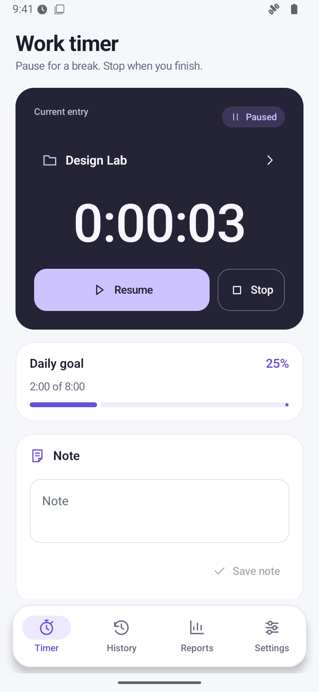
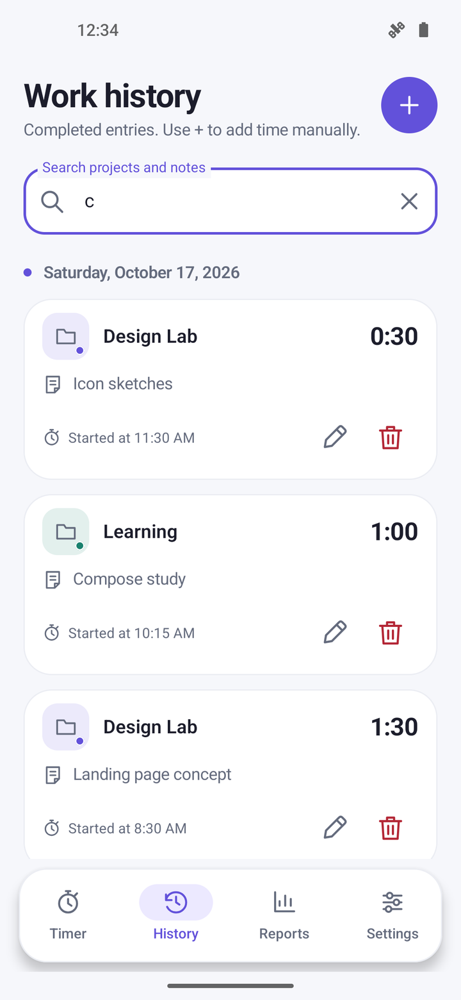
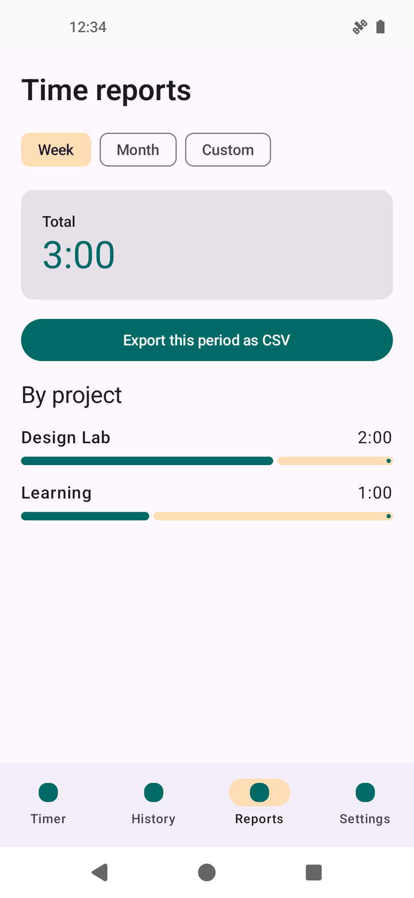
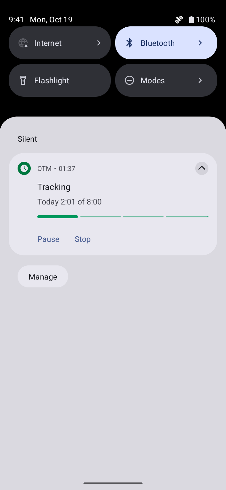
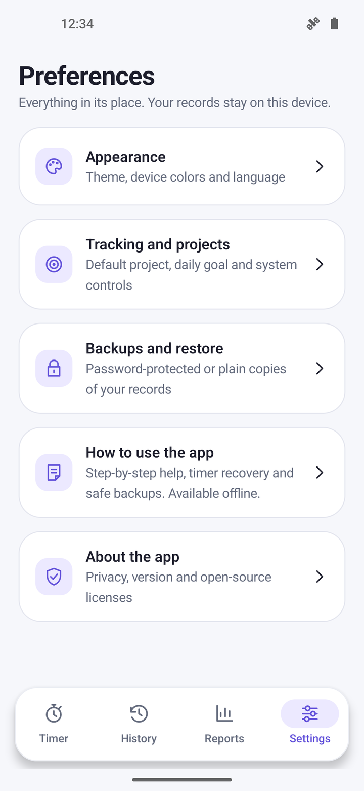
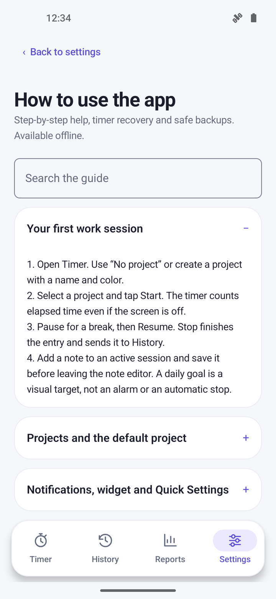
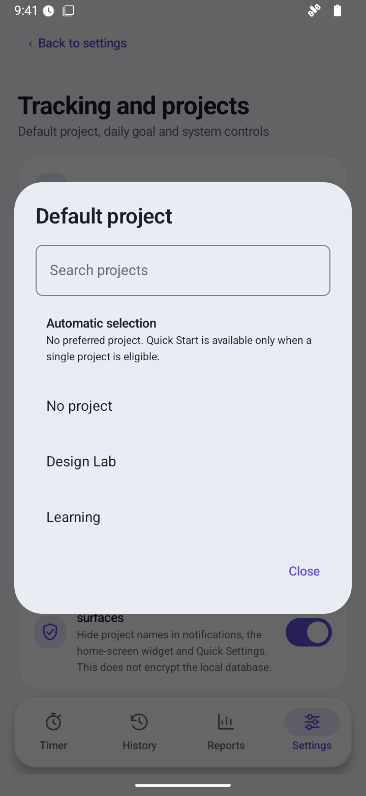
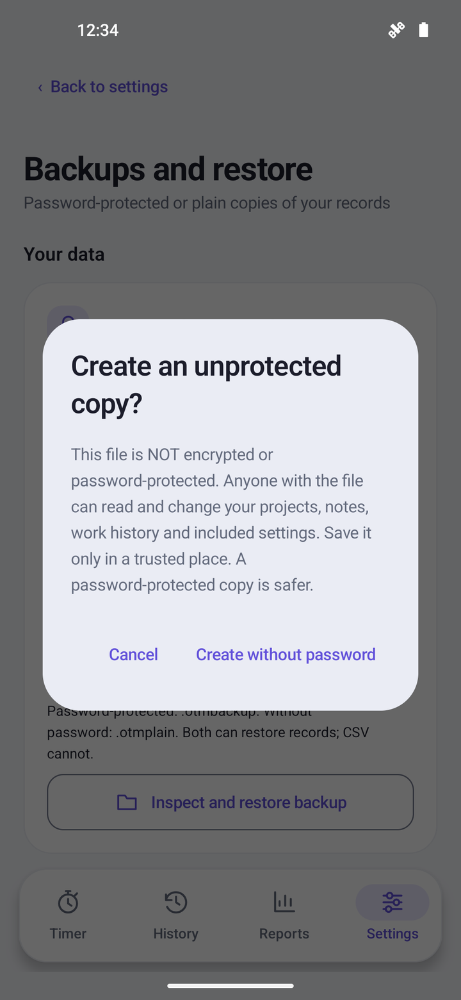
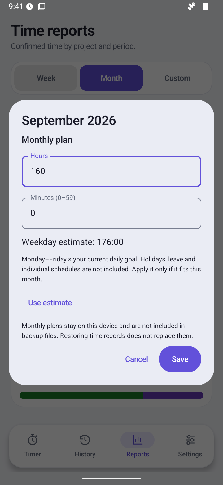
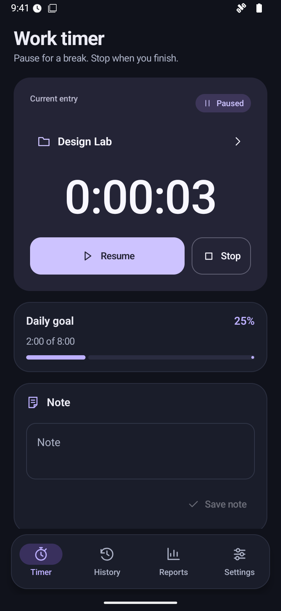

  

<h1 align="center">OTM</h1>

  Open TimeManager — a work-time tracker for Android. 
  No account, ads, or cloud sync.

  <strong>Android 12+</strong> · English and Russian · GPL-3.0-only

  <a href="https://github.com/AnoY606-git/Open-TimeManager/releases/latest">Download APK</a> ·
  <a href="docs/USER_GUIDE.md#english">User guide</a> ·
  <a href="docs/README.md#english">Documentation</a> ·
  <a href="README.md">Русский</a>

Choose a project, start the timer, and get on with your work. OTM
keeps your sessions, lets you fill in missing entries, and shows where your time
went. Your records stay on your device; no internet connection is needed.

The description and screenshots below cover the current `main` branch after
1.1.0. The latest stable release is **1.1.0**; monthly plans, settings-section
search, updated notification progress, and the experimental HyperIsland client
are currently available in builds from current source.

## What you can do

- **Track your work.** Start, pause, switch projects, and add notes.
- **Keep history tidy.** Add work you forgot to time, then search and edit entries.
- **See the bigger picture.** View weekly, monthly, or custom reports. Set a separate plan for each month and check its balance. Export CSV for spreadsheets.
- **Keep a backup.** Save password-encrypted files, move your records, and choose whether to merge or replace data.
- **Stay in control.** Use the notification, home-screen widget, or Quick Settings tile. The notification shows daily goal progress across all projects.
- **Make it yours.** Choose a theme, language, daily goal, and default project. Find the right section by a setting name or keyword. Built-in help works offline.

Settings → Android and device includes an optional **Live Updates and
HyperIsland** switch, off by default. On supporting Android 16 builds, the
standard request can serve Pixel, Samsung Now Bar, and OPPO/OnePlus Live Alerts;
the system decides eligibility and appearance.
[Android's shared mechanism and OEM surfaces](https://blog.google/products-and-platforms/platforms/android/android-16/)

An experimental local timer template is prepared for HyperOS 3.
**OTM's island has not been confirmed to work:** Xiaomi service registration,
an app ID, signing-certificate registration, and scenario approval have not been
obtained, and the client has not been tested on a physical HyperOS device.
Detecting the protocol makes the switch available, including on Android 15;
it does not establish app approval.
[Xiaomi's onboarding requirements](https://dev.mi.com/xiaomihyperos/documentation/detail?pId=2132) ·
[Behavior and limits](docs/USER_GUIDE.md#live-updates-and-hyperisland)

## Screenshots

| Timer | History |
| :---: | :---: |
|  |  |
| **Monthly balance** | **Notification** |
|  |  |

Settings, help, default project, and unprotected backup

| Settings | Help |
| :---: | :---: |
|  |  |
| **Default project** | **Unprotected backup** |
|  |  |

Monthly plan and dark theme

| Monthly plan | Dark theme |
| :---: | :---: |
|  |  |

The gallery contains 20 genuine `main` development screenshots from an AOSP
Android 16 / API 36 emulator with made-up records. They show OTM's interface and
ordinary Android notification, not HyperOS or a working island. Capture provenance
is documented separately.
[About the screenshots](docs/screenshots/README.md#english).

## Install or update

1. Open the [latest stable release](https://github.com/AnoY606-git/Open-TimeManager/releases/latest).
2. Download the APK. For version 1.1.0, choose **`Open-TimeManager-1.1.0.apk`**.
3. Open it on a device running Android 12 or later. If Android asks, allow
   installation from the app you used to open the APK.

The app is distributed through GitHub Releases, not Google Play.
[What's new in 1.1.0](docs/releases/1.1.0.md#english).

New local and CI builds are named **OTM** on your device.
They produce **`OTM.apk`**; the application ID is unchanged. Previously published
releases keep their original APK names. To use current `main` features,
[build from source](docs/BUILDING.md#english).

Before updating, save and check an encrypted backup. Version 1.1.0 uses the same
signing key as 1.0.0; an emulator upgrade preserved existing data. Test builds
may use a different key. **If Android reports a signature mismatch, do not
uninstall the app or clear its data:** that can erase your history.

## Get started

1. On Timer, choose a project or leave No project selected.
2. Tap Start. Use Pause for a break and Stop when you finish.
3. Open History and Reports to review your records and totals.

Usually work on the same project? Set it under Settings → Tracking and projects.
For more help, see the [user guide](docs/USER_GUIDE.md#english)
or How to use the app in Settings.

## Your data

The app has no internet permission, advertising, or analytics. Android's automatic
backup is disabled, so save your own copies. If you select a cloud location in
Android's file picker, that provider will upload the file.

- **`.otmbackup`** is a password-encrypted copy. A forgotten password cannot be recovered.
- **`.otmplain`** has no password. Anyone with the file can read and change it.
- **CSV** is for spreadsheets, not restoring the app.

Finish the timer before restoring a copy. **Replace removes your current
projects and history**, so save a separate, checked backup first. Hiding project
names in notifications does not encrypt the database or exported files.
Monthly plans, language, the default-project choice, and the Live Updates and
HyperIsland preference stay on the device, outside backups. Changing the daily goal
does not change saved monthly plans.

[Backups and restore](docs/USER_GUIDE.md#backups-and-restore) ·
[Security and privacy](docs/SECURITY.md#english)

## Useful links

| I want to… | Read |
| --- | --- |
| Learn how to use the app | [User guide](docs/USER_GUIDE.md#english) |
| Build the project and run checks | [Building from source](docs/BUILDING.md#english) |
| Suggest an improvement or contribute a fix | [Contributing](CONTRIBUTING.md#english) |
| See what changed | [Changelog](CHANGELOG.md) |
| Report a vulnerability | [Private security reports](SECURITY.md#english) |

There is no cloud sync, team workspace, or CSV import. System controls depend
on Android and your device's software. Live Updates and HyperIsland do not
guarantee a special notification style; realme and vivo are unverified.
Battery impact has not been measured.

## License

Project code is licensed under [GNU GPL v3 only](LICENSE).
See [authors](AUTHORS.md), [attribution](ATTRIBUTION.md),
and [third-party licenses](THIRD_PARTY_NOTICES.md) for credits and notices.
