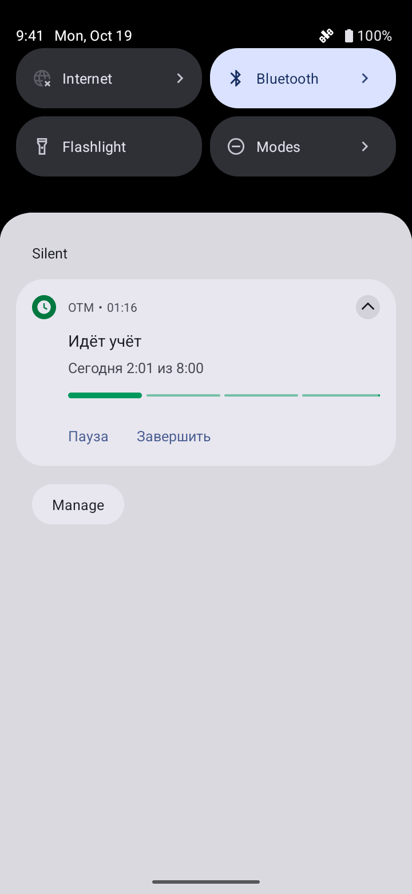
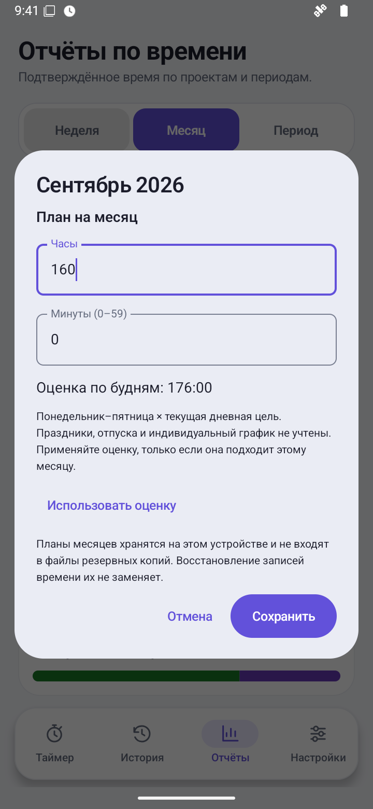

  

<h1 align="center">OTM</h1>

  Open TimeManager — трекер рабочего времени для Android. 
  Без аккаунта, рекламы и облачной синхронизации.

  <strong>Android 12+</strong> · Русский и English · GPL-3.0-only

  <a href="https://github.com/AnoY606-git/Open-TimeManager/releases/latest">Скачать APK</a> ·
  <a href="docs/USER_GUIDE.md">Руководство</a> ·
  <a href="docs/README.md">Документация</a> ·
  <a href="README.en.md">English</a>

Выберите проект, запустите таймер и займитесь делом. OTM сохранит
рабочие сессии, поможет дополнить историю и покажет, куда ушло время.
Все записи хранятся на вашем устройстве; подключение к интернету не нужно.

Описание и скриншоты ниже относятся к текущей ветке `main` после выпуска 1.1.0.
Последний стабильный релиз — **1.1.0**; месячные планы, поиск по разделам настроек,
обновлённый прогресс уведомления и экспериментальный клиент HyperIsland пока
доступны в сборках из текущих исходников.

## Что умеет приложение

- **Учитывать время.** Начинайте работу, делайте паузы, переключайте проекты и добавляйте заметки.
- **Приводить историю в порядок.** Вносите пропущенную работу вручную, ищите и редактируйте записи.
- **Показывать итоги.** Смотрите отчёты за неделю, месяц или свой период. Задавайте отдельный план для каждого месяца и следите за балансом. Выгружайте данные в CSV для таблиц.
- **Сохранять копии.** Создавайте зашифрованные файлы с паролем, переносите данные и выбирайте, объединить их или заменить.
- **Быть под рукой.** Управляйте таймером через уведомление, виджет или плитку быстрых настроек. Уведомление показывает прогресс дневной цели по всем проектам.
- **Подстраиваться под вас.** Выбирайте тему, язык, дневную цель и проект по умолчанию. Находите нужный раздел по названию настройки или ключевому слову. Встроенная справка работает офлайн.

В «Настройки → Android и устройство» есть необязательный переключатель
**«Live Updates и HyperIsland»**, выключенный по умолчанию. На поддерживающих
сборках Android 16 стандартный запрос может использоваться Pixel, Samsung Now Bar
и OPPO/OnePlus Live Alerts; решение о допуске и внешнем виде принимает система.
[Общий механизм Android и OEM-поверхности](https://blog.google/products-and-platforms/platforms/android/android-16/)

Для HyperOS 3 подготовлен экспериментальный локальный шаблон таймера.
**Работа острова OTM пока не подтверждена:** ещё не получены регистрация сервиса
Xiaomi, app ID, привязка сертификатов и согласование сценария; на физическом
HyperOS-устройстве клиент не проверен. Обнаружение протокола позволяет включить
опцию, в том числе на Android 15, но не подтверждает допуск приложения.
[Условия Xiaomi](https://dev.mi.com/xiaomihyperos/documentation/detail?pId=2132) ·
[Поведение и ограничения](docs/USER_GUIDE.md#live-updates-и-hyperisland)

## Как выглядит

| Таймер | История |
| :---: | :---: |
|  |  |
| **Баланс месяца** | **Уведомление** |
|  |  |

Настройки, справка, проект по умолчанию и копия без пароля

| Настройки | Справка |
| :---: | :---: |
|  |  |
| **Проект по умолчанию** | **Копия без пароля** |
|  |  |

План месяца и тёмная тема

| План месяца | Тёмная тема |
| :---: | :---: |
|  |  |

В галерее 20 реальных снимков dev-сборок `main` на эмуляторе AOSP Android 16 /
API 36 с вымышленными записями или пустой новой установкой для настроек. Они показывают интерфейс OTM и обычное уведомление
Android, а не HyperOS или работающий остров. Происхождение кадров указано отдельно.
[Подробнее о скриншотах](docs/screenshots/README.md).

## Установка и обновление

1. Откройте [последний стабильный релиз](https://github.com/AnoY606-git/Open-TimeManager/releases/latest).
2. Скачайте APK. Для версии 1.1.0 это **`Open-TimeManager-1.1.0.apk`**.
3. Откройте файл на устройстве с Android 12 или новее. Если Android попросит,
   разрешите установку для приложения, из которого открываете APK.

Приложение распространяется через GitHub Releases, а не Google Play.
[Что нового в 1.1.0](docs/releases/1.1.0.md).

В новых локальных и CI-сборках название приложения на устройстве — **OTM**.
Эти сборки создают файл **`OTM.apk`**; идентификатор приложения не изменён.
У уже опубликованных выпусков имена APK остаются прежними. Для функций текущей
ветки `main` используйте [сборку из исходников](docs/BUILDING.md).

Перед обновлением сохраните и проверьте зашифрованную копию. Версия 1.1.0
подписана тем же ключом, что и 1.0.0; обновление с сохранением данных проверено
на эмуляторе. У тестовых сборок может быть другая подпись.
**Если Android сообщает о несовместимости подписи, не удаляйте приложение
и не очищайте его данные:** так можно потерять историю.

## С чего начать

1. На экране «Таймер» выберите проект или оставьте «Без проекта».
2. Нажмите «Начать». Для перерыва используйте паузу, а в конце работы — «Завершить».
3. Откройте «Историю» и «Отчёты», чтобы посмотреть записи и итоги.

Часто работаете над одним проектом? Задайте его в «Настройки → Учёт и проекты».
Ответы на остальные вопросы есть в [руководстве](docs/USER_GUIDE.md)
и в разделе «Как работать с приложением» внутри приложения.

## Ваши данные

Приложение не запрашивает доступ к интернету и не содержит рекламы или аналитики.
Автоматическое резервное копирование Android отключено — копии нужно сохранять
самостоятельно. При выборе облачного хранилища в системном окне файл загрузит
туда выбранный вами сервис.

- **`.otmbackup`** — зашифрованная копия с паролем. Забытый пароль восстановить нельзя.
- **`.otmplain`** — копия без пароля. Любой получатель сможет прочитать и изменить её.
- **CSV** — файл для таблиц, не копия для восстановления.

Перед восстановлением завершите таймер. Режим **«Заменить» удаляет текущие
проекты и историю**, поэтому сначала сохраните отдельную проверенную копию.
Скрытие названий в уведомлении не шифрует базу данных или экспортируемые файлы.
Планы месяцев, язык, проект по умолчанию и выбор «Live Updates и HyperIsland»
хранятся только на устройстве и не входят в копии. Сохранённые месячные планы
не меняются вместе с дневной целью.

[Как устроены копии](docs/USER_GUIDE.md#копии-и-восстановление) ·
[Безопасность и приватность](docs/SECURITY.md)

## Полезные ссылки

| Задача | Куда перейти |
| --- | --- |
| Разобраться с приложением | [Руководство пользователя](docs/USER_GUIDE.md) |
| Собрать проект и запустить проверки | [Сборка из исходников](docs/BUILDING.md) |
| Предложить улучшение или исправление | [Участие в проекте](CONTRIBUTING.md) |
| Посмотреть изменения | [История версий](CHANGELOG.md) |
| Сообщить об уязвимости | [Приватное сообщение](SECURITY.md) |

Облачной синхронизации, командной работы и импорта CSV нет. Работа системных
кнопок зависит от Android и прошивки. Live Updates и HyperIsland не гарантируют
особый вид уведомления; realme и vivo не проверены. Влияние на расход батареи
не измерялось.

## Лицензия

Код проекта распространяется по [GNU GPL v3 only](LICENSE).
[Авторы](AUTHORS.md), [источники заимствований](ATTRIBUTION.md)
и [лицензии сторонних компонентов](THIRD_PARTY_NOTICES.md) указаны отдельно.
