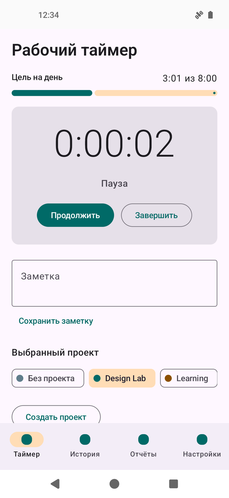
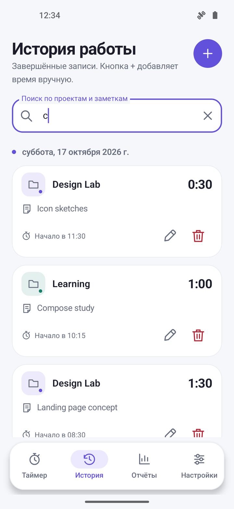
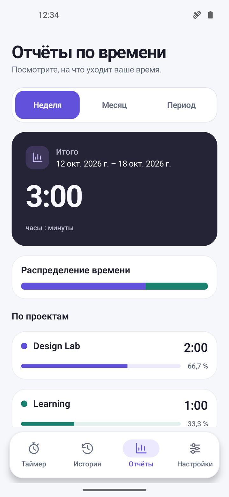
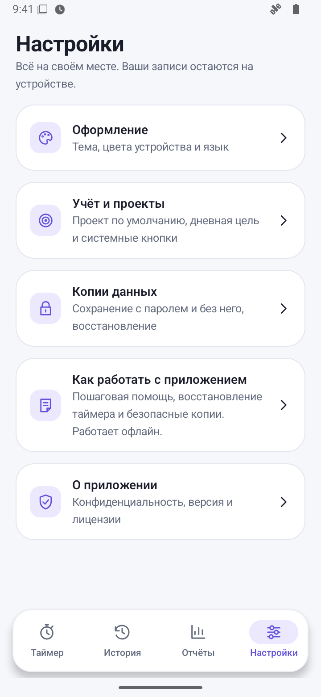
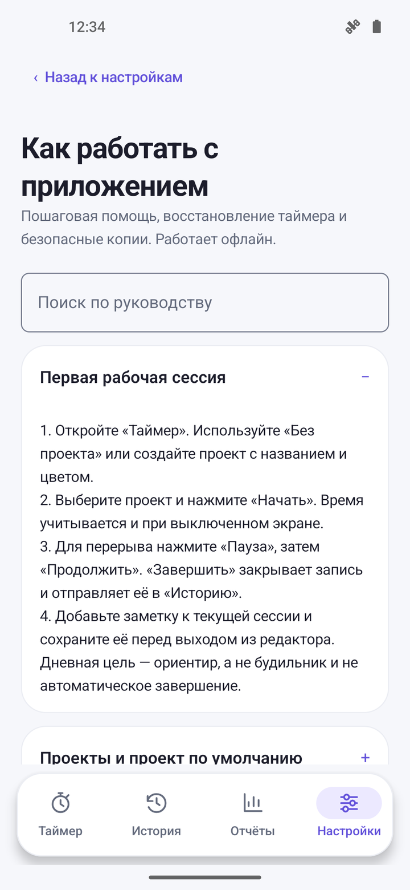
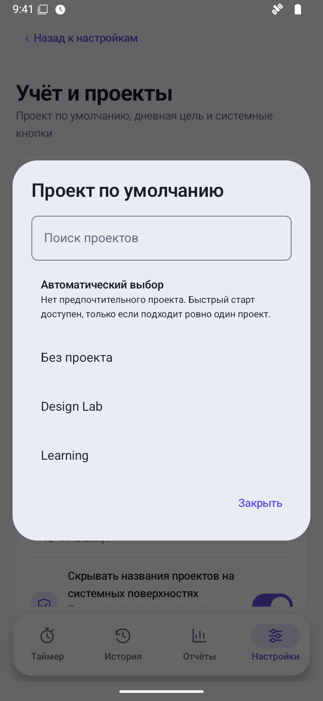
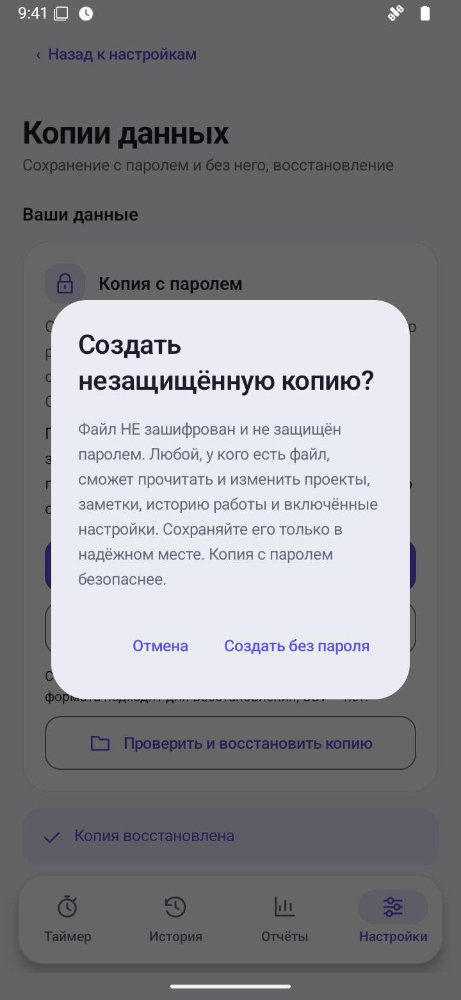
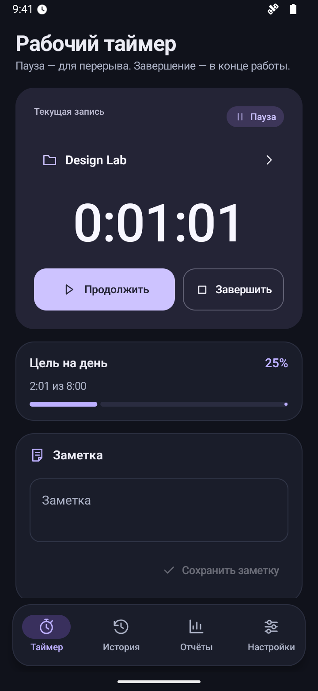

<p align="center">
  
</p>

<h1 align="center">Open TimeManager</h1>

<p align="center">
  <strong>Ваше время. Ваш фокус. Ваши данные.</strong><br>
  Локальный трекер рабочих часов для Android — без аккаунта и облачного сервера.
</p>

<p align="center">
  <a href="#установка"></a>
  
  
  <a href="LICENSE"></a>
</p>

<p align="center">
  <a href="https://github.com/AnoY606-git/Open-TimeManager/releases/latest">Скачать</a> ·
  <a href="#интерфейс">Интерфейс</a> ·
  <a href="#возможности">Возможности</a> ·
  <a href="#установка">Установка</a> ·
  <a href="docs/README.md">Документация</a> ·
  <a href="README.en.md">English</a>
</p>

---

Запустите таймер, выберите проект и сосредоточьтесь на работе. История и отчёты
покажут, куда ушло время, а записи останутся под вашим контролем — без рекламы,
аналитики и обязательной регистрации.

## Интерфейс

Графитовые блоки, фиолетовый акцент и понятная навигация. Для готовящейся
**стабильной 1.1.0** (`versionCode = 3`) запланированы 16 реальных кадров из
**эмулятора Android 16 / API 36** — по восемь на русском и английском,
только с демонстрационными записями.

> [!NOTE]
> Пересъёмка 1.1 ещё не выполнена. Основные экраны и тёмный таймер ниже пока
> показывают прежний интерфейс 1.0; шесть файлов новых сценариев ожидают съёмки.
> Подготовленная галерея не подтверждает проверку или публикацию 1.1.

| **01 · Таймер** | **02 · История** |
| :---: | :---: |
|  |  |
| **03 · Отчёты** | **04 · Настройки** |
|  |  |

<details>
<summary><strong>Новые сценарии 1.1 · руководство, проект по умолчанию и безопасность копии</strong></summary>

Планируемые реальные кадры: файлы будут добавлены после съёмки на эмуляторе.

| **Руководство офлайн** | **Проект по умолчанию** | **Предупреждение о копии** |
| :---: | :---: | :---: |
|  |  |  |

</details>

<details>
<summary><strong>Посмотреть тёмную тему</strong></summary>

<p align="center">
  
</p>

</details>

[Условия съёмки и демонстрационные данные →](docs/screenshots/README.md)

## Возможности

| Фокус на работе | Порядок в истории | Понятные итоги |
| --- | --- | --- |
| Запуск, пауза и продолжение одной сессии. Цветные проекты, заметки и безопасное переключение между задачами. | Ручные записи, поиск, редактирование и подтверждение удаления. Архивирование проектов без потери истории. | Неделя, месяц или свой период до 10 лет. Итоги и доли проектов, экспорт CSV в UTF-8. |
| **Ваши данные** | **Всегда под рукой** | **Ваш интерфейс** |
| Зашифрованные `.otmbackup` по умолчанию; отдельная необязательная `.otmplain` без шифрования и защиты подлинности. Предпросмотр, «Объединить» и «Заменить». | Уведомление, виджет и плитка быстрых настроек. Приватный режим скрывает названия проектов на системных поверхностях. | Русский и английский языки. Светлая и тёмная темы, цвета устройства, адаптация к широкому экрану и крупному шрифту. |

В 1.1 настройки разделены на пять экранов: «Оформление», «Учёт и проекты»,
«Копии данных», «Как работать с приложением», «О приложении». Встроенное руководство с
поиском охватывает 10 тем и работает офлайн на RU/EN. Проект по умолчанию —
локальная настройка: активная сессия и явный выбор на свободном таймере имеют
приоритет; в backup этот выбор не переносится.

Android 12+ поддерживает цвета устройства и адаптивный виджет с предпросмотром.
На Android 13+ можно запросить системный диалог добавления плитки; на Android 12
она добавляется вручную. Закрепление виджета зависит от лаунчера и подтверждения
пользователя. В приложении есть переход в системные настройки и справочные
подсказки об ограничениях производителя — без частных OEM API и обязательного
отключения экономии батареи. [Подробнее →](docs/USER_GUIDE.md)

Проекты и история загружаются ограниченными порциями, включая отдельный поиск
проектов в редакторе записей. Системные команды защищены от устаревших нажатий.
Таймер использует монотонные часы устройства; после перезагрузки неизвестное
время требует проверки, а не превращается в выдуманные рабочие часы.

## Установка

> [!TIP]
> **Готовится стабильная 1.1.0** (`versionCode = 3`) — [изменения и обновление](docs/releases/1.1.0.md).
> [Страница v1.1.0](https://github.com/AnoY606-git/Open-TimeManager/releases/tag/v1.1.0) предназначена для итоговых APK, metadata и результатов проверок после публикации.
> Эти документы не подтверждают подпись или прохождение CI. До публикации последняя
> доступная стабильная версия — [1.0.0](https://github.com/AnoY606-git/Open-TimeManager/releases/tag/v1.0.0), `Open-TimeManager-1.0.0.apk`.

Для разработки также доступны артефакты успешного [GitHub Actions](https://github.com/AnoY606-git/Open-TimeManager/actions/workflows/ci.yml):
`open-timemanager-debug-and-unsigned-release-apks`. Для просмотра и скачивания
артефактов Actions может потребоваться вход в GitHub. В отличие от официального
APK релиза, debug-файл подписан тестовым ключом, а release-файл из CI не подписан.

**Требования:** Android 12+ (API 31). Целевая версия — Android 16 / API 36.
Сначала проверьте сборку на эмуляторе. При обновлении установленного приложения
сохраняйте данные; несовпадение подписи — не повод удалять приложение без копии.

При переходе с preview/debug сначала остановите таймер и создайте отдельную
проверенную зашифрованную копию. Подпись 1.0 отличается от debug-подписи;
несовместимую установку нельзя обновить поверх с сохранением данных одним APK.
Для 1.1 планируется тот же production-ключ, что у 1.0: совпадение сертификата и
обновление без удаления данных должны подтверждаться итоговыми release assets.
Не удаляйте приложение и не очищайте данные ради обхода ошибки подписи.
[Порядок выпуска и ограничения обновления →](docs/releases/1.1.0.md)

<details>
<summary><strong>Сборка из исходников · Linux и Windows</strong></summary>

Готовый APK в репозитории не подписывается production-ключом. Перед распространением release APK владелец должен подписать его отдельно.

Для воспроизводимой локальной сборки на Linux x86_64 нужны Python 3.12+ и `curl`:

```bash
python3 scripts/bootstrap.py --accept-licenses
scripts/with-toolchain.sh ./gradlew --no-daemon \
  :core:test :app:testDebugUnitTest :app:lintDebug :app:assembleDebug
```

Bootstrap проверяет SHA-256 закреплённых JDK 17, Android command-line tools и Gradle Wrapper. Можно не использовать bootstrap: установите JDK 17 и Android SDK API 36 с platform-tools, задайте `JAVA_HOME` и `ANDROID_HOME` или `ANDROID_SDK_ROOT`. Обёртка ниже распознаёт эти стандартные переменные; явные `OTM_JAVA_HOME`/`OTM_ANDROID_HOME` имеют приоритет.

Обёртка сохраняет стандартные `ANDROID_USER_HOME` и `GRADLE_USER_HOME`, если не заданы соответствующие `OTM_*`-переопределения. Bootstrap не перезаписывает существующий `local.properties`: если в нём указан `sdk.dir`, согласуйте его с выбранным SDK, чтобы Gradle и обёрнутый `adb` использовали один комплект инструментов.

### Windows / PowerShell

Linux-bootstrap и `scripts/with-toolchain.sh` не предназначены для нативного Windows. Установите JDK 17 и [Android command-line tools](https://developer.android.com/studio#command-tools), распаковав последние в `Android\Sdk\cmdline-tools\latest`. Для проекта используйте путь без кириллицы, например `C:\src\Open-TimeManager`: Android Gradle Plugin проверяет путь на Windows.

```powershell
$env:JAVA_HOME = 'C:\path\to\jdk-17'
$env:ANDROID_HOME = "$env:LOCALAPPDATA\Android\Sdk"
$env:ANDROID_SDK_ROOT = $env:ANDROID_HOME
$env:Path = "$env:JAVA_HOME\bin;$env:ANDROID_HOME\platform-tools;$env:ANDROID_HOME\cmdline-tools\latest\bin;$env:Path"
sdkmanager --sdk_root="$env:ANDROID_HOME" --licenses
sdkmanager --sdk_root="$env:ANDROID_HOME" 'platform-tools' 'platforms;android-36' 'build-tools;36.0.0'
.\gradlew.bat --no-daemon :core:test :app:testDebugUnitTest :app:lintDebug :app:assembleDebug
```

Замените `JAVA_HOME` на реальный каталог JDK 17. Зависимости проекта загружает Gradle Wrapper; отдельно устанавливать Gradle не нужно. Для Python-проверок нужен Python 3.11+: `python -m unittest discover -s scripts/tests -p 'test_*.py' -v` и `python scripts/check_repository.py`. Только тесты исполнения Bash-обёртки пропускаются на нативном Windows; для их выполнения используйте Linux или WSL.

</details>

<details>
<summary><strong>Установка APK и полный прогон проверок</strong></summary>

### Проверка устройства и установка

Для установки нужен Android 12+ эмулятор или подключённое устройство с включённой USB-отладкой; подтвердите RSA-запрос на экране устройства. После сборки проверьте, что обёрнутая команда `adb devices` показывает его в состоянии `device`, и установите точный debug-артефакт:

```bash
scripts/with-toolchain.sh adb devices
scripts/with-toolchain.sh adb -s SERIAL install -r app/build/outputs/apk/debug/app-debug.apk
```

На Windows после настройки окружения выше используйте:

```powershell
& "$env:ANDROID_HOME\platform-tools\adb.exe" devices -l
& "$env:ANDROID_HOME\platform-tools\adb.exe" -s SERIAL install -r app/build/outputs/apk/debug/app-debug.apk
```

Debug APK подписан автоматически созданным Android debug/test-ключом и предназначен только для тестирования. `app/build/outputs/apk/release/app-release-unsigned.apk` не установится, пока владелец не подпишет его своим release-ключом.

Замените `SERIAL` идентификатором выбранного устройства из `adb devices -l`,
особенно если одновременно подключены телефон и эмулятор. `install -r` обновляет
совместимо подписанное приложение без очистки данных.

CI добавляет к APK контрольные суммы SHA-256 и точный исходный commit. Перед распространением подписанного APK выполните [проверочный список поставки](docs/RELEASING.md): после подписи контрольная сумма изменяется, а получателю должен быть доступен соответствующий исходный код.

Ссылка на private-репозиторий не даёт исходники получателю, у которого нет к нему доступа.

Для полной проверки репозитория:

```bash
python3 scripts/check_repository.py
scripts/with-toolchain.sh ./gradlew --no-daemon \
  :core:test :app:testDebugUnitTest :app:testReleaseUnitTest \
  :app:lintDebug :app:lintRelease :app:assembleDebug :app:assembleRelease \
  :app:compileDebugAndroidTestKotlin
scripts/with-toolchain.sh python3 scripts/check_release_apk.py app/build/outputs/apk/release/app-release-unsigned.apk
```

Проверка release APK использует `aapt2` из Build Tools 36.0.0 по `ANDROID_HOME`/`ANDROID_SDK_ROOT` либо явный `--aapt2`. Она проверяет итоговые package/SDK/permissions после manifest merger, отсутствие debug/test-only, целостность ZIP и точные офлайн legal assets; подпись для этой проверки не требуется. Обёртка выбирает тот же SDK, что и при сборке; со своим настроенным SDK можно вызывать Python напрямую.

</details>

## Приватность без аккаунта

- **Без сети:** приложение не запрашивает разрешение `INTERNET`.
- **На вашем устройстве:** проекты, заметки, настройки и история находятся во внутреннем хранилище Android.
- **Без скрытого переноса:** автоматический cloud backup Android отключён; экспорт и импорт открывают системный выбор файла по вашему действию.
- **Без рекламы и аналитики:** учёт времени не требует аккаунта или сервера.

> [!IMPORTANT]
> Пароль зашифрованной копии восстановить нельзя. `.otmplain` и CSV — открытый
> текст: любой получатель может читать содержимое, а `.otmplain` также менять
> без доказательства подлинности. Выбранный вами файловый провайдер может быть облачным.
> «Заменить» безвозвратно
> заменяет локальную историю после подтверждения — сначала сохраните отдельную проверенную копию.

<details>
<summary><strong>Формат данных и гарантии восстановления</strong></summary>

Зашифрованные `.otmbackup` используют прежний совместимый контейнер `OTMB1`: PBKDF2-HMAC-SHA256 (310 000 итераций), AES-256-GCM и аутентифицированный заголовок. Текущий payload schema v2 сохраняет цвета и даты проектов, тему, dynamic color, privacy mode и дневную цель; v1 читается с безопасными значениями по умолчанию. Язык управляется Android/AppCompat, а проект по умолчанию хранится локально: ни один из этих выборов не переносится в backup. Приложение применяет мобильный операционный предел **4 МиБ** и до 20 000 проектов, записей и сегментов; базовый формат и core-кодек имеют жёсткий верхний предел 50 МиБ и 200 000 элементов. Эти большие пределы описывают формат, а не объём, который принимает Android UI.

Необязательная `.otmplain` использует отдельный контейнер `OTMP1`, тот же payload
schema v2, строгую проверку структуры и те же лимиты. Это **не шифрование и не
аутентификация**: SHA-256 обнаруживает случайное повреждение, но любой может
изменить файл и пересчитать сумму. Создание требует отдельного подтверждения;
перед просмотром восстановления приложение предупреждает о недоверенном файле.
Обычное действие создания остаётся зашифрованным; ошибка пароля не означает
разрешение на открытый формат. Копия содержит подтверждённые закрытые интервалы,
не текущий открытый отрезок: сначала поставьте таймер на паузу или завершите его.

Шифрование относится к `.otmbackup`, а не к `.otmplain`, CSV или локальной базе данных.

Пароль копии восстановить нельзя. Неверный пароль и повреждение намеренно выглядят одинаково. Перед экспортом приложение завершает ожидающее намерение настроек и берёт строгий последовательный снимок Room и DataStore; ошибка чтения или согласования отменяет создание файла. Успешный режим «Заменить» безвозвратно удаляет текущие локальные проекты и историю перед импортом в одной транзакции — сначала сохраните отдельную проверенную копию. При ошибке или отмене транзакция Room откатывается, но это не отмена после успешного подтверждения. Настройки DataStore согласуются после Room-коммита через устойчивый журнал; последующие ручные изменения упорядочиваются тем же журналом и не могут быть перезаписаны более старым намерением восстановления. Если DataStore уже сохранил выбор, но системное privacy-зеркало не записалось, UI показывает предупреждение, а журнал повторяет запись после перезапуска. Общей транзакции между двумя хранилищами приложение не заявляет. Восстановление блокируется, пока таймер запущен, приостановлен или требует проверки.

Подробнее: [руководство пользователя](docs/USER_GUIDE.md), [модель безопасности](docs/SECURITY.md), [формат backup и CSV](docs/BACKUP_FORMAT.md).

</details>

## Документация

| Начать пользоваться | Разобраться в данных | Участвовать в разработке |
| --- | --- | --- |
| [Руководство пользователя](docs/USER_GUIDE.md) | [Безопасность и приватность](docs/SECURITY.md) | [Вклад в проект](CONTRIBUTING.md) |
| [Скриншоты](docs/screenshots/README.md) | [Формат backup и CSV](docs/BACKUP_FORMAT.md) | [Подготовка релиза](docs/RELEASING.md) |
| [История изменений](CHANGELOG.md) | [Сообщить об уязвимости](SECURITY.md) | [Проверки и APK](https://github.com/AnoY606-git/Open-TimeManager/actions) |

## Ограничения

- нет синхронизации, командных функций, веб-кабинета, геолокации, payroll и импорта CSV;
- перенос выполняется вручную через Storage Access Framework;
- системные кнопки зависят от разрешения уведомлений и ограничений прошивки/OEM; сам учёт внутри приложения остаётся доступен;
- подписанный APK распространяется через GitHub Releases, не через Google Play;
- независимый криптографический аудит, проверка Google Play policy и подтверждённые метрики батареи/производительности не проводились;
- CI настроен на инструментальные тесты API 31 и 36; фактический результат конкретного релиза указан отдельно в `VERIFICATION.md`. Локальная сборка не доказывает прохождение на физическом устройстве;
- сокращены повторные системные обновления, но выигрыш батареи не измерен; на Android 16 можно отдельно включить запрос Live Updates для текущего таймера. Продвижение решают Android и оболочка, закрытая интеграция с Super Island/HyperIsland не заявляется.

## Участие и лицензия

Предложения и исправления приветствуются по правилам [CONTRIBUTING.md](CONTRIBUTING.md). Уязвимости сообщайте приватно по [SECURITY.md](SECURITY.md), не публикуя чувствительные детали в issue.

Собственный код Open TimeManager распространяется только по GNU GPL v3. Сторонние компоненты и происхождение адаптированных инструментов перечислены в [ATTRIBUTION.md](ATTRIBUTION.md) и [THIRD_PARTY_NOTICES.md](THIRD_PARTY_NOTICES.md). В приложении эти тексты доступны офлайн в настройках.

---

<p align="center"><sub>Открытый код. Локальные данные. Время для важного.</sub></p>
